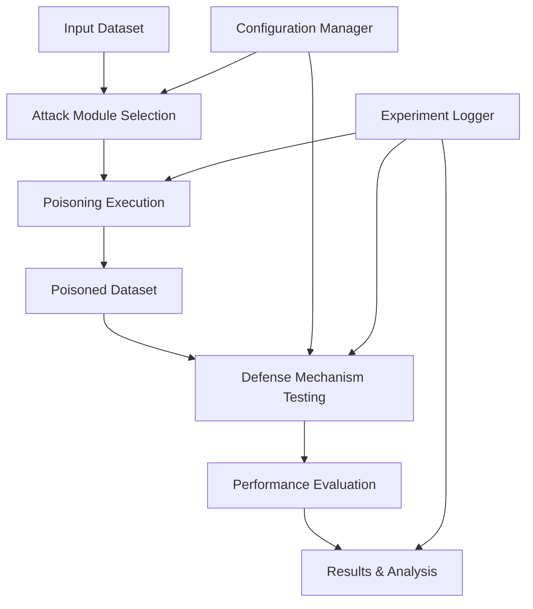
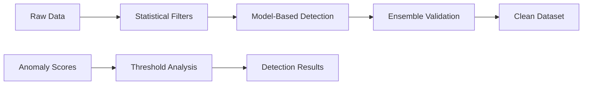

<div align="center">

# 🛡️ Data Poisoning Toolkit
**A Comprehensive Framework for ML Security Research**

[](https://www.python.org/downloads/)
[](https://pytorch.org/)
[](https://opensource.org/licenses/MIT)
[](https://www.blackhat.com/eu-25/)
[](https://ieee.org/)

*Submitted at BlackHat Europe 2025 | Submitted to IEEE Conference*

</div>

---

## 📋 Abstract

The **Data Poisoning Toolkit** is an advanced framework designed for evaluating the robustness of machine learning models against adversarial data poisoning attacks and testing the effectiveness of various defense mechanisms. This toolkit addresses critical security vulnerabilities in ML systems by providing a comprehensive suite of attack vectors and defense strategies, enabling researchers and security professionals to conduct reproducible experiments across multiple real-world datasets.

**Key Contributions:**
- Novel implementation of D-SPO (Differentiable Shielded Poisoning Oracle) attack methodology
- Comprehensive multi-layered defense framework with statistical and model-based detection
- Extensive evaluation across critical infrastructure domains (energy, water, transportation)
- Reproducible experimental framework for academic research and security assessment

---

## 👥 Authors

<table>
<tr>
<td align="center">
<strong>Muhammet Anil Yagiz</strong><br>
<a href="https://scholar.google.com.tr/citations?hl=en&user=KDqGjjYAAAAJ">📚 Google Scholar</a>
</td>
<td align="center">
<strong>Muhammed Arif Dayi</strong><br>
📧 Research Contributor
</td>
<td align="center">
<strong>Dr. Polat Goktas</strong><br>
<em>Principal Investigator</em><br>
<a href="https://scholar.google.com.tr/citations?user=RDvcMSUAAAAJ&hl=en">📚 Google Scholar</a>
</td>
</tr>
</table>

---

## 🏗️ Framework Architecture

The Data Poisoning Toolkit follows a modular architecture designed for extensibility and reproducible research:



### Core Components

- **🎯 Attack Framework**: Sophisticated poisoning implementations with gradient-based optimization
- **🛡️ Defense Suite**: Multi-layered detection mechanisms combining statistical and ML approaches
- **📊 Dataset Integration**: Support for critical infrastructure domains
- **🔬 Experiment Engine**: Configurable and reproducible evaluation pipeline

---

## ⚔️ Advanced Attack Implementations

### 🎯 Sophisticated Poisoning Techniques

| Attack Method | Description | Technical Approach | Use Case |
|---------------|-------------|-------------------|----------|
| **D-SPO Enhanced** | Differentiable Shielded Poisoning Oracle with gradient optimization | Novel gradient-based technique for targeted model manipulation | Advanced adversarial scenarios |
| **Greedy Residue** | Optimization-based data manipulation with residual analysis | Iterative poisoning with mathematical optimization | Resource-constrained attacks |
| **Random Baseline** | Statistical poisoning for comparative analysis | Probabilistic data corruption | Baseline comparison studies |

### 🔬 Attack Capabilities

- **Gradient-Based Optimization**: Advanced mathematical techniques for maximum impact
- **Targeted Model Manipulation**: Specific vulnerability exploitation
- **Stealth Operations**: Minimal detection probability while maintaining effectiveness
- **Scalable Implementation**: Support for large-scale dataset poisoning

---

## 🛡️ Comprehensive Defense Mechanisms

### 📊 Multi-Layered Detection Strategy

#### Statistical Anomaly Detection
- **LOF (Local Outlier Factor)**: Density-based anomaly identification
- **KDE (Kernel Density Estimation)**: Probabilistic outlier detection
- **DBSCAN Clustering**: Density-based spatial clustering for anomalies

#### Model-Based Detection
- **Isolation Forest**: Ensemble-based anomaly detection
- **PCA Analysis**: Dimensionality reduction with anomaly identification
- **Quantile/Median Filtering**: Statistical threshold-based detection

### 🎯 Defense Effectiveness



---

## 📊 Dataset Support Matrix

| Domain | Dataset | Task Type | Target Variable | Security Relevance |
|--------|---------|-----------|-----------------|-------------------|
| 🌊 **Environmental** | Water Quality | Regression | Hardness | Infrastructure Security |
| ⚡ **Energy** | Smart Grid | Regression | Power Distribution | Critical Infrastructure |
| 🚗 **Transportation** | Traffic Index | Regression | Traffic Flow | Urban Security |
| ☀️ **Renewable Energy** | Solar Power | Regression | Energy Yield | Grid Stability |
| 🌊 **Water Monitoring** | Brisbane Quality | Regression | Water Speed | Environmental Security |

---

## 🚀 Installation & Usage

### 📦 PyPI Installation (Recommended)

```bash
# Install the toolkit
pip install datapoisontoolkit

# For research environments with Jupyter support
pip install datapoisontoolkit[research]
```

### 🔧 Development Installation

```bash
# Clone the repository
git clone https://github.com/arifs122/data-poison-toolkit
cd data-poison-toolkit

# Install in development mode
pip install -e .

# Install research dependencies
pip install -r requirements.txt
```

### 🔬 Command Line Interface

```bash
# Help
    cd src
    python -m datapoisontoolkit.cli

# Interactive mode
    python -m datapoisontoolkit.cli interactive

# List available attacks and defenses
    python -m datapoisontoolkit.cli list

```

---

## 📚 Academic Integration

### 🎓 Citation Format

```bibtex
@software{yagiz2025datapoisontoolkit,
  title={Data Poisoning Toolkit: A Comprehensive Framework for ML Security Research},
  author={Yagiz, Muhammet Anil and Dayi, Muhammed Arif and Goktas, Polat},
  year={2025},
  url={https://github.com/[username]/data-poison-toolkit},
  note={Presented at BlackHat Europe 2025, Submitted to IEEE Conference}
}
```

### 🏛️ Conference Context

- **BlackHat Europe 2025**: Security implications and practical attack demonstrations
- **IEEE Conference**: Theoretical contributions and experimental methodology
- **Academic Research**: Framework for reproducible ML security evaluation

---

## 🔒 Security & Ethics

### ⚖️ Responsible Use

> **⚠️ IMPORTANT**: This framework is designed exclusively for academic research and authorized security testing. Users must comply with applicable laws and ethical guidelines.

### 🛡️ Ethical Guidelines

- **Academic Use Only**: Framework intended for research and educational purposes
- **Authorized Testing**: Only use in controlled environments with proper authorization
- **Responsible Disclosure**: Report vulnerabilities through appropriate channels
- **Legal Compliance**: Ensure compliance with local laws and regulations

### 🔐 Security Disclaimers

- No support for malicious applications
- Users responsible for legal and ethical use
- Framework includes safety mechanisms and logging
- Institutional review recommended for research use

---

## 📄 License & Contributing

### 📜 License

This project is licensed under the MIT License - see the [LICENSE](LICENSE) file for details.

### 🤝 Contributing

We welcome contributions from the security research community! Please see our [Contributing Guidelines](CONTRIBUTING.md) for details on:

- Code standards and style guidelines
- Pull request process
- Issue reporting
- Security vulnerability reporting

### 🌟 Acknowledgments

- Security research community for vulnerability insights
- Academic institutions supporting ML security research
- Open source contributors and maintainers

---

<div align="center">

**🔬 Advancing ML Security Through Research**

[](https://github.com/[username]/data-poison-toolkit)
[](https://github.com/[username]/data-poison-toolkit/fork)

*For questions or collaboration opportunities, please contact the research team.*

</div>
